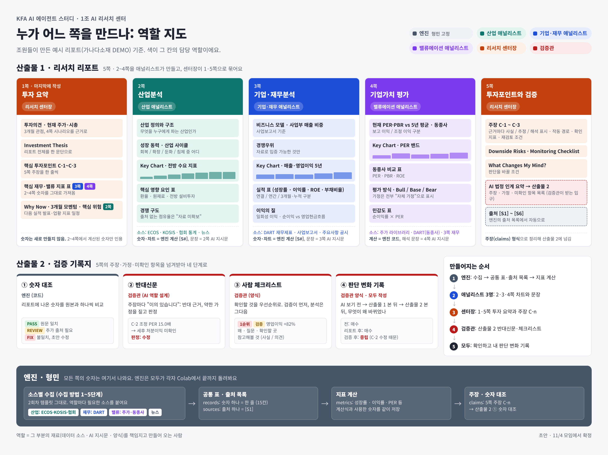

# 1조 AI 리서치 센터

KFA AI 에이전트 스터디 1조(6명)가 함께 만드는 리서치 에이전트입니다. 종목 하나를 넣으면 리서치 리포트와, 그 리포트의 주장을 검증한 기록지가 나오는 것을 목표로 합니다. 조원들이 손으로 만든 예시 리포트(가나다소재 DEMO)에서 출발해 산출물 형식을 먼저 정하고 엔진을 거기에 맞춰 만드는 순서(Top-down)로 설계했습니다.

## 산출물

| 산출물 | 구성 | 만드는 사람 |
|---|---|---|
| 1. 리서치 리포트 (5쪽) | 1쪽 투자 요약, 2쪽 산업분석, 3쪽 기업·재무분석, 4쪽 기업가치 평가, 5쪽 투자포인트(주장 C-1~C-3)와 검증 | 2~4쪽은 산업·기업·재무·밸류에이션 애널리스트, 1·5쪽은 리서치 센터장 |
| 2. 검증 기록지 | ① 숫자 대조, ② 반대신문, ③ 사람 체크리스트, ④ 판단 변화 기록 | ①은 엔진, ②·③은 검증관, ④는 모두 |

리포트의 숫자와 차트는 모두 엔진이 계산한 값(출처 번호 [S#] 포함)만 쓰고, 1쪽은 새 숫자를 만들지 않고 2~4쪽 숫자만 인용합니다. 엔진 설명은 [docs/engine.md](../docs/engine.md)에 있습니다.

## 만들어지는 순서

1. 엔진(박형민): 수집 → 공통 표·출처 목록 → 지표 계산
2. 애널리스트 3명: 2·3·4쪽 차트와 문장
3. 센터장: 1·5쪽 투자 요약과 주장 C-n
4. 검증관: 산출물 2의 반대신문과 체크리스트
5. 모두: 확인하고 각자 판단 변화 기록

## 상태

역할 지도는 초안이며 11/4 1조 모임에서 확정합니다. 역할은 엔진(박형민)만 고정이고, 나머지는 조원별 1~3순위 희망을 받아 배정합니다.
